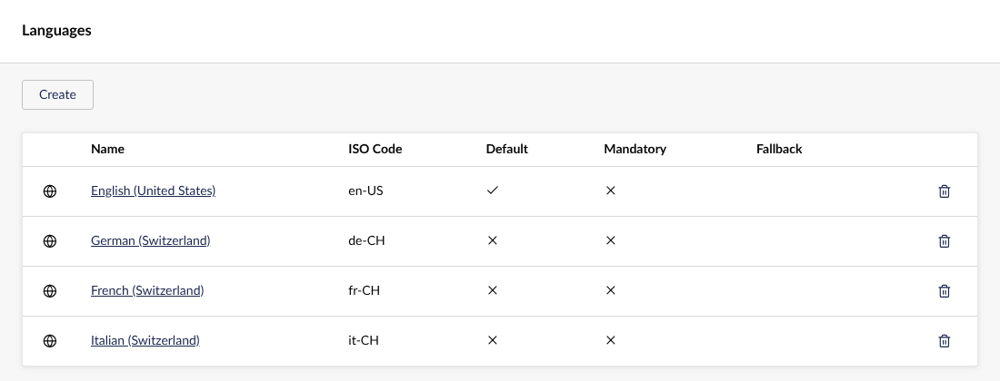
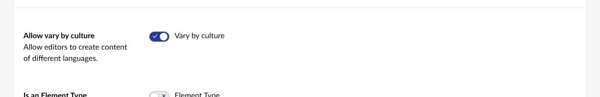
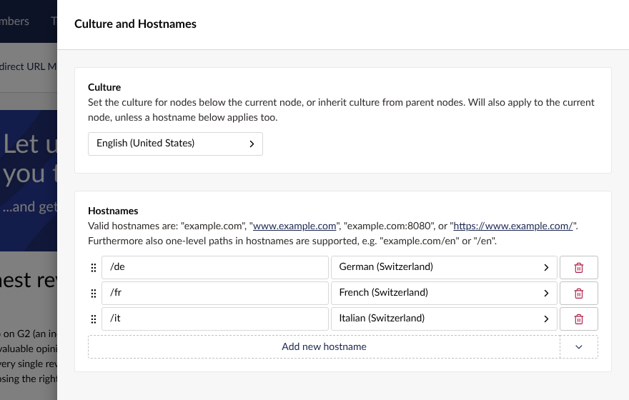

# Installation guide — Supertext Translation for Umbraco

For administrators setting up the package on an Umbraco site.

> **Just want to try it?** `demo/` contains a ready-to-run container with Umbraco 17, the Clean starter kit in English, German, French and Italian (Switzerland), and this package. It also runs the public Supertext demo. See the *Demo* section of the [developer guide](DEVELOPER.md#demo-railway).

## Requirements

| | |
| --- | --- |
| Umbraco | 17 LTS (tested), 18 (supported) |
| .NET | 10 |
| Languages | At least two languages, and document types that **vary by culture** |
| Supertext | An account with an API key — see [Set the API key](#2-set-the-api-key) |
| Network | The web server must reach `https://api.supertext.com` over HTTPS (and, for [Translation review](#translation-review), Supertext's review service) |

## 1. Add the package

The package is not on NuGet yet. Build it from the repository and add it from a local folder (it contains the [Supertext SDK](https://github.com/Supertext/Supertext-API-SDK-and-Guide) it uses; there is nothing else to install):

```bash
git clone https://github.com/Supertext/Umbraco-Supertext-Translation
dotnet pack Umbraco-Supertext-Translation/src/Supertext.Umbraco.Translation -c Release -o ./packages
# in your Umbraco project:
dotnet nuget add source /path/to/packages --name supertext-local
dotnet add package Supertext.Umbraco.Translation --version 0.1.0
```

(Or reference `src/Supertext.Umbraco.Translation/Supertext.Umbraco.Translation.csproj` from your solution.)

Restart the site. The package registers itself; there is nothing to enable in the backoffice.

## 2. Set the API key

Get the key first:

1. **Supertext account:** no account yet? [Create one at supertext.com](https://www.supertext.com/person/en/account/signin) (log in or create an account with your e-mail address).
2. **API key:** generate it at [supertext.com → Integrations → API](https://www.supertext.com/en/integrations/api). This requires the **Admin** role in your Supertext account; ask your Supertext account admin otherwise.

Then configure it, either:

- **Environment variable (recommended):** `SUPERTEXT_API_KEY=...`. It wins over the setting and keeps the key out of your repository.
- **appsettings.json:**

  ```json
  "Supertext": {
    "ApiKey": "..."
  }
  ```

Supertext shows the key as `Supertext-Auth-Key <key>`; paste it with or without that prefix. The dialog warns editors when no key is configured and links to the account signup and API key pages.

## 3. Languages

The package uses Umbraco's own multilingual setup:

1. **Settings › Languages:** add the languages you translate into.

   

2. **Settings › Document Types:** for each page type, enable **Allow vary by culture** (*Settings* tab), and on the properties that hold text, **Vary by culture**. Text in block lists is translated when the block list property varies by culture.

   

3. **Culture and Hostnames** on the home page (*Actions* ⋯): give each language a URL, e.g. `/de`, `/fr`, `/it`, or its own domain.

   

Turning on *Vary by culture* for a document type that already has content moves the values of its own properties to the default language. **Properties that come from a composition keep their old shared values**, which then no longer show. Re-save those pages in the default language, or move the values with a small migration; the demo does this in `DemoSetupService.MoveSharedValuesToEnglish`.

4. **Supertext language per Umbraco language:** **Settings › Supertext**, box *Languages*. Every Umbraco language has a combo box with Supertext's languages (shown as *name (code)*, the names in your backoffice language), where Supertext offers it a *Formal/informal* choice, and a **Translation review** checkbox (see [Translation review](#translation-review)). Choose and click **Save**; the choice applies to the next translation, no restart needed. It is stored in Umbraco's database (`umbracoKeyValue`, key `Supertext.Umbraco.Translation.Languages`).

   

   Supertext accepts exactly these target codes (from its language list, October 2026); the combo box offers exactly these:

   | Language | Supertext codes |
   | --- | --- |
   | German, English, French, Italian, Portuguese | `de-DE`, `de-CH`, `de-AT`, `en-US`, `en-GB`, `fr-FR`, `fr-CH`, `it-IT`, `it-CH`, `pt-PT`, `pt-BR` |
   | Chinese, Serbian | `zh-Hans`, `zh-Hant`, `sr-Latn`, `sr-Cyrl` |
   | Swiss German | `gsw-u-sd-chzh` (Zurich), `gsw-u-sd-chbe` (Bern) |
   | All others, without region | `bg`, `cs`, `da`, `el`, `es`, `fi`, `hr`, `hu`, `ja`, `ko`, `nb`, `nl`, `pl`, `rm`, `ru`, `sk`, `sl`, `sq`, `sv`, `tr` |

   What the combo box preselects while nothing is saved, and what a language nobody chose is sent as:

   - An Umbraco culture that **is** one of these codes (apart from upper/lower case and `_`/`-`) is used as it is: `de-CH`, `fr-CH`, `es`, `nl` (*same code*).
   - **Where Supertext's default is obvious, it is used** (*Supertext default*):

     | Umbraco culture | Supertext language |
     | --- | --- |
     | `de`, `en`, `fr`, `it`, `pt` | `de-DE`, `en-US`, `fr-FR`, `it-IT`, `pt-PT` |
     | `zh`, `zh-CN`, `zh-SG` / `zh-TW`, `zh-HK`, `zh-MO` | `zh-Hans` / `zh-Hant` |
     | `sr`, `sr-Latn-RS` | `sr-Latn` |
     | a region of a language without regions | the language: `es-ES` → `es`, `nl-NL` → `nl`, `nb-NO` → `nb` |

     Choose another code if you want one, e.g. `de` → `de-CH` for Swiss spelling.
   - **Every other culture needs a choice** (`en-IE`, `de-LI`, `fr-BE`, `gsw`, `sr-RS`): its combo box shows *— choose —* and the dashboard says *Choose a Supertext language before translating into …*. Until then the dialog marks it *not mapped*, translating into it says *has no Supertext language yet*, and nothing is sent for it.
   - The same choice is used when the language is the **source**: Supertext gets its language without region (`de-CH` → `de`, `en-US` → `en`).

   *Formal/informal* (formal = Sie/vous/Lei, informal = du/tu, default = Supertext decides) is offered only for Supertext languages that have it; English, Swiss German, Romansh, Albanian and Serbian don't.

   **Override in appsettings.json** (for automated setups): `Supertext:Languages:<culture>` wins over the screen, value by value. A language whose `Code` (or `Politeness`, `Review`) is set there shows that value on the dashboard, marked *set in appsettings.json*, instead of the combo box. `Enabled: false` hides a language from the dialog (appsettings only).

```json
"Supertext": {
  "Languages": {
    "de": { "Code": "de-CH", "Politeness": "more" },
    "es-ES": { "Code": "es" },
    "fr-CH": { "Review": true },
    "en-GB": { "Enabled": false }
  }
}
```

## Translation review

With **Translation review**, people check the translations on the website itself and correct them there: customers or Supertext linguists open the original and the translated page side by side in Chrome with the *Supertext Localization Review* extension and fix texts in a side panel. Their corrections come back into Umbraco.

Turn it on per language that is translated **into**: **Settings › Supertext**, box *Languages*, tick **Translation review** for that language → **Save**. Untick it to turn it off again; nothing else changes. (In appsettings.json: `Supertext:Languages:<culture>:Review`, which wins over the checkbox.)

- Translations into that language then go through Supertext's review service instead of directly to Supertext. It answers exactly like Supertext and passes everything on with your API key, so billing, languages, formal/informal and error messages stay the same.
- The review service keeps every translation of your account. A text it has translated before gets the same translation again (without a new Supertext call), and once a reviewer has corrected it, the corrected text.
- **Corrections arrive with the next translation:** after a review, translate the pages into that language again (**Translate with Supertext**, replacing the existing language) to write the corrections into Umbraco as drafts. As always, translating again overwrites manual changes in the translated texts.
- Reviewers get a review link for your site from Supertext; nothing to set up in Umbraco.
- The review service works with keys of the **live** Supertext API. With a staging or testing `Endpoint`, leave review off.
- *Export for translation* and *Import translation* don't use the review service. The API key check still goes directly to Supertext.
- `Supertext:ReviewUrl` is the review service's address (default: Supertext's review service). Set it to `""` to turn review off for every language; the dashboard then says so.

## Interface languages

The package's own screens (the **Translate with Supertext** button and menu entry, the dialog, its notifications and error messages) are in English, German, French and Italian. They follow each backoffice user's **UI Culture** (Users › the user, or the user's own profile: *UI Culture*); any regional variant (e.g. *Deutsch (Schweiz)*) uses its language, and other languages fall back to English. Nothing to configure.

## 4. Permissions

Editors need the **Update** permission on the page and access to the target languages (user group *Languages*, or *Allow access to all languages*). The default *Editors* group has both.

The same applies to **Export for translation** and **Import translation** in the dialog (XLIFF 1.2 or HTML files, see the user guide): exporting needs *Update* in the chosen target languages, importing needs it on the page and language each file belongs to. They need nothing to configure and no API key (they don't call Supertext). Files are limited to 10 MB (the dialog refuses larger files before reading them, the server checks again) and are read in memory, never stored. A reverse proxy in front of the site must allow request bodies of up to 30 MB for imports (the file travels JSON-encoded).

## 5. Check it works

Open **Settings › Supertext** (the *Supertext* tab on the Settings dashboard). It shows the package version, the API endpoint, whether a key is set and the result of the automatic **API key check** with its time; **Check API key** runs it again (no cost, nothing is translated). The check also runs by itself when the key changes. Its messages:

| Result | Message |
| --- | --- |
| `ok` | API key checked: the connection to Supertext works. |
| `invalid` | Supertext rejected the API key. Check that you copied the whole key, or generate a new one at supertext.com → Integrations → API (requires the Admin role). No Supertext account yet? Create one at supertext.com. |
| `missing` | No API key is set yet. No Supertext account yet? Create one at supertext.com. Generate your API key at supertext.com → Integrations → API (requires the Admin role). |
| `unreachable` | The API key couldn't be checked because Supertext can't be reached. The settings are saved; check again later. |
| `error` | The API key couldn't be checked: Supertext answered with an error (*status*). The settings are saved; check again later. |

In the dashboard, *supertext.com* links to the [account signup](https://www.supertext.com/person/en/account/signin) and *supertext.com → Integrations → API* to the [API key page](https://www.supertext.com/en/integrations/api) (requires the Admin role).

Then open a page, click **Translate with Supertext**, choose a language, and click **Translate** — see the [user guide](USER_GUIDE.md).

## Version information sent to Supertext

The setting **Send version information to Supertext** is on by default. It sends a short report to Supertext (the *Supertext Commando Center*) after an update of the package, Umbraco or .NET and when the result of the API key check changes, so Supertext support can see which version you run and whether your key works. A report contains:

- the site URL (Umbraco's `WebRouting:UmbracoApplicationUrl`, else the address the backoffice was opened at),
- the versions of this package, Umbraco, .NET and the bundled Supertext SDK,
- whether an API key is set, and the result of the latest API key check (status, time, HTTP status, Supertext's error code),
- the address of the ping route below.

It never contains content, the API key or personal data. Reports are sent from the server, in the background, with a 3-second timeout; a report that fails is not retried for an hour and never affects the backoffice or a translation. The package keeps what it last reported (and the key check) in Umbraco's key-value table (`umbracoKeyValue`, key `Supertext.Umbraco.Translation.ReporterState`); the key itself is not stored there, only a fingerprint to notice a changed key.

**Turn it off** with `"Supertext": { "SendVersionReports": false }` in appsettings.json, or the environment variable `SUPERTEXT_VERSION_REPORTS=0` (it wins over the setting; `1` turns reports on). Off means nothing is sent and the ping route answers 404. The API key check keeps working either way. **Settings › Supertext** shows whether reports are on.

**Ping route.** While reports are on, Supertext checks that the site is reachable with `GET /umbraco/supertext/ping?challenge=…`: a public route (no login) that only echoes the challenge (`{"ok":true,"plugin":"Umbraco-Supertext-Translation","challenge":"…"}`, `Cache-Control: no-store`). If a firewall, a CDN rule or IP restriction protects `/umbraco`, allow `GET /umbraco/supertext/ping` or Supertext will show the site as unreachable; nothing else depends on it.

## All settings

All under `Supertext` in appsettings.json (or environment variables like `Supertext__PollTimeoutSeconds`):

| Setting | Default | |
| --- | --- | --- |
| `ApiKey` | `""` | API key; `SUPERTEXT_API_KEY` wins |
| `Endpoint` | `https://api.supertext.com/v1/` | API base URL; `SUPERTEXT_API_ENDPOINT` wins. For [Translation review](#translation-review) use the checkbox instead |
| `ReviewUrl` | Supertext's review service | Address of the review service for languages with *Translation review* on; `SUPERTEXT_REVIEW_URL` wins (an empty variable keeps the setting). `""` turns review off for every language. Only change it when Supertext gives you another address |
| `PollIntervalSeconds` | `2` | Seconds between status checks |
| `PollTimeoutSeconds` | `240` | Maximum seconds to wait for one language |
| `Languages.<culture>.Code` | not set: the choice on Settings › Supertext | Overrides the Supertext language chosen on **Settings › Supertext** (e.g. `de` → `de-CH`, `en-IE` → `en-GB`; see [Languages](#3-languages)) |
| `Languages.<culture>.Politeness` | not set: the choice on Settings › Supertext | Overrides *Formal/informal*: `more`, `less` or `default` |
| `Languages.<culture>.Review` | not set: the checkbox on Settings › Supertext | Overrides *Translation review*: `true` or `false` |
| `Languages.<culture>.Enabled` | `true` | `false` hides the language from the dialog |
| `SendVersionReports` | `true` | *Send version information to Supertext* (see [Version information sent to Supertext](#version-information-sent-to-supertext)); `SUPERTEXT_VERSION_REPORTS=0`/`1` wins |
| `PlainTextEditors` | `Umbraco.TextBox`, `Umbraco.TextArea` | Property editors translated as plain text |
| `RichTextEditors` | `Umbraco.RichText`, `Umbraco.TinyMCE` | Translated as HTML, including blocks inside the rich text |
| `BlockEditors` | `Umbraco.BlockList`, `Umbraco.BlockGrid`, `Umbraco.SingleBlock` | Searched for translatable properties in their blocks |
| `ExcludedProperties` | `[]` | Property aliases never translated (copied as they are), e.g. `["code"]` for code snippets |

Values that are only a URL, e-mail address, path or number are never sent to Supertext.

## Updating

Build and add the new package version as in step 1, then restart the site.

## Uninstalling

```bash
dotnet remove package Supertext.Umbraco.Translation
```

Translations already made stay in place; they are ordinary Umbraco content.

## Troubleshooting

| Symptom | Cause / fix |
| --- | --- |
| The button doesn't appear | Hard-refresh the backoffice after installing. Check the user's Update permission on the page. |
| *No Supertext API key is configured* | [Generate a key](https://www.supertext.com/en/integrations/api) (Admin role required), set `SUPERTEXT_API_KEY` (or `Supertext:ApiKey`) and restart. |
| *Authentication failed* | Wrong or revoked key; paste it again (the prefix is optional) or [generate a new one](https://www.supertext.com/en/integrations/api). |
| *The language … has no Supertext language yet* / *not mapped* | The Umbraco culture has no obvious Supertext language: choose one in its combo box on **Settings › Supertext** (see [Languages](#3-languages)) and save. |
| *Supertext does not support this language pair* | A code from `Supertext:Languages:<culture>:Code` in appsettings.json that Supertext doesn't offer (e.g. `es-ES` instead of `es`, `zh-CN` instead of `zh-Hans`), or the same language as the source: fix or remove it (the combo box only offers valid codes). |
| *Supertext offers no formal or informal tone for this language* | `Politeness` in appsettings.json is `more`/`less` for a language without it (English, Swiss German, Romansh, Albanian, Serbian); set it to `default` or remove it. |
| *Authentication failed* only for languages with *Translation review* | The review service only works with keys of the live Supertext API: with a staging or testing `Endpoint`, leave review off. |
| Reviewers' corrections don't show up in Umbraco | They arrive with the next translation: translate the page into that language again. Check that the language's *Translation review* is ticked (and that `ReviewUrl` isn't empty). |
| *Could not save the languages* (Settings › Supertext) | The user needs access to the Settings section; check the log for the reason. |
| *Supertext rejected the API key* (Settings › Supertext) | Wrong, incomplete or revoked key: copy it again or [generate a new one](https://www.supertext.com/en/integrations/api), restart, then **Check API key**. |
| *Supertext can't be reached* / *answered with an error* (Settings › Supertext) | The server can't reach `https://api.supertext.com` (proxy, firewall) or Supertext had a problem; check again later. |
| *The translation from Supertext was empty or incomplete* | Supertext answered without some texts. Translate again; if it persists, send the log entry to Supertext support. |
| *Too many requests* | Supertext's per-second limit; the package retries automatically (up to 4 times). |
| *Timed out waiting for the Supertext translation* | Very long pages; raise `PollTimeoutSeconds` (and proxy timeouts). |
| *does not vary by culture* | Enable *Allow vary by culture* on the document type (see *Languages*). |
| Translated page has no URL / 404 | Publish the parent pages in that language too, and set Culture and Hostnames. |
| A field isn't translated | Its property must vary by culture and use one of the editors above; check `ExcludedProperties`. |

Errors are logged with the prefix `Supertext:` (Settings › Log Viewer).

## Security note

The API key is read only from the environment or appsettings and sent only to the configured endpoint (and, for languages with Translation review, the review service, which passes it on to Supertext); it is never part of a version report. The ping route is the package's only public route; it reads nothing and answers only the challenge. The backoffice API checks the editor's Update permission for the document and target languages before translating. Saving the language mapping on Settings › Supertext needs access to the Settings section.
