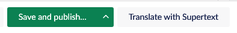
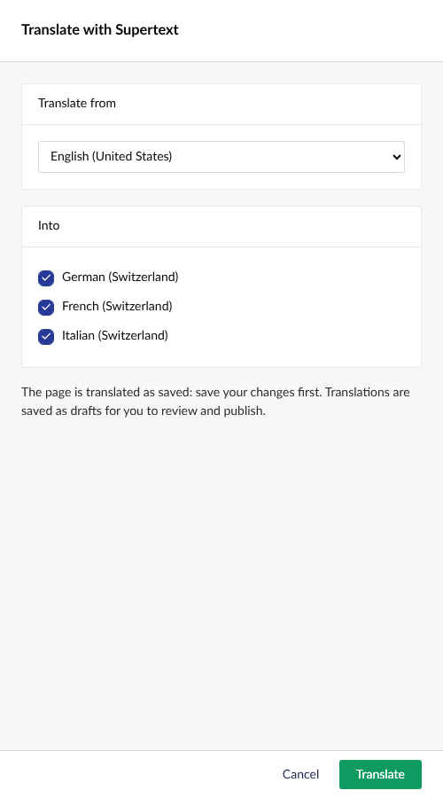
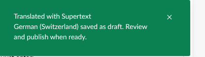
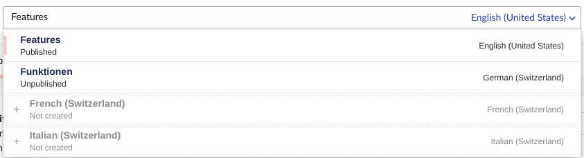
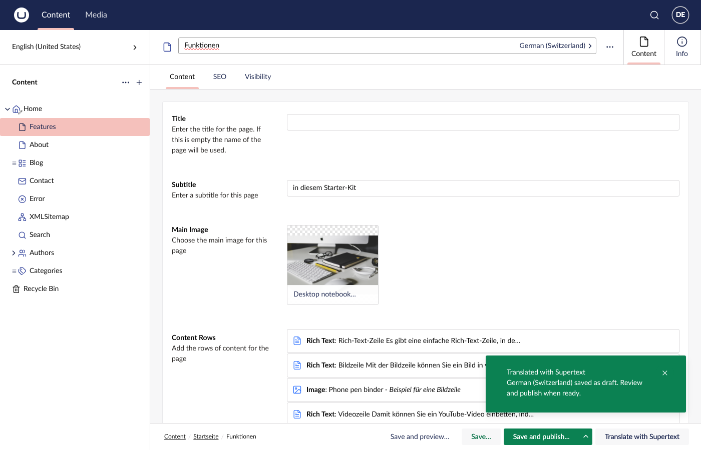
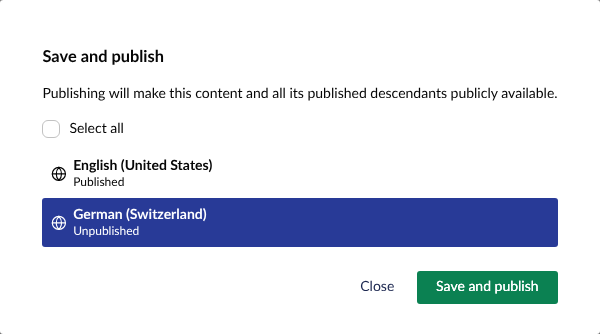
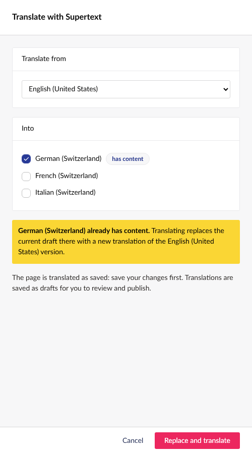

# User guide — Supertext Translation for Umbraco

For editors. Once an administrator has installed the package (see [INSTALLATION.md](INSTALLATION.md)), you translate a page with one button. Supertext writes the other language versions, and you review and publish them as usual.

The Supertext button, dialog and messages follow the interface language you chose in your Umbraco profile (English, German, French or Italian). The screenshots show the English interface.

## Translate a page

1. Open the page in the **Content** section. Save your changes first: the page is translated as saved.
2. Click **Translate with Supertext** next to *Save and publish*. (It's also in the page's *Actions* menu, ⋯, in the tree and in the header.)

   

3. Choose the language to translate **from** (usually the default language) and the languages to translate **into**. Languages the page doesn't exist in yet are preselected.

   

4. Click **Translate**. Each language goes to Supertext as one request, typically a few seconds. A green message confirms which languages were saved:

   

## Review and publish

The translations are saved as **drafts**: visitors don't see them until you publish. Switch to a language in the language menu of the page header. Translated languages show the translated page name and *Unpublished*:

Read through the translation and correct anything you like:

Then **Save and publish** and choose the language:

Umbraco only gives a page a URL in a language when the pages above it are published in that language too. Translate and publish the **home page first**, then its subpages. The German page is then live, under `/de/`:

## Translating again

If a language already has content, the dialog marks it **has content**. Translating into it replaces its current draft with a fresh translation of the source language, so Supertext asks first:

Your published version stays online until you publish the new draft.

**Translation review:** if your administrator turned on *Translation review* for a language, reviewers (your colleagues or Supertext linguists) check and correct the translations on the website. Their corrections come into Umbraco the next time you translate the page into that language: after a review, translate it again (replacing the language) and publish. Texts reviewed once keep their corrected wording in later translations.

## Export for translation and import a translated file

Instead of translating with Supertext's AI right away, you can download the page's texts as a file, have it translated elsewhere (by a translator, in a translation tool such as Trados, memoQ or Phrase, or in Supertext's web app) and import the translated file again. Both are at the bottom of the **Translate with Supertext** dialog.

**Export:**

1. Open the dialog, choose the language to translate **from** and tick the languages to translate **into**, as for translating.
2. Under **Export for translation**, choose the **File format**:
   - **XLIFF 1.2 (for translation tools)**: the standard format of translation tools. Formatting appears as protected tags, so translators can't break it. One file can hold several languages. This is the better choice for translation tools and agencies.
   - **HTML (one language per file)**: a web page with the texts, for Supertext's web app or anyone who translates HTML. Tick exactly one target language. Translators must leave the page's head (the `supertext:` lines) and the `data-st-id` attributes alone.
3. Click **Download file** (for example `umbraco-<document key>-de-CH.xlf`) and send it to your translator, or upload it to Supertext's web app. The page is exported as saved.

**Import:**

1. Open the dialog on any page (the file says which page and language it belongs to).
2. Under **Import translation**, choose the translated file. If the language already has content, tick **Replace languages that already have content** (as when translating again).
3. Click **Import translation**. The texts are saved as a **draft** of that language, with the same rules as a translation with Supertext. Review and publish it.

The summary shows, per page and language:

| Line | Meaning |
| --- | --- |
| *Imported: 12* | Texts written into the draft. |
| *Skipped, source changed since the export: 1* | The source text was edited after the export, so the translation may be outdated. Tick **Also import texts whose source changed since the export** to import them anyway. |
| *Not translated in the file: 1* | The file has no translation for these texts (an empty target in XLIFF). |
| *Formatting changed, not imported: 1* | The translation broke or added formatting (tags, links). Fix it in the file and import again. |
| *Not in the file: 1* | Texts added to the page after the export. |

Texts that aren't imported keep the text of the source language in the draft. An HTML file imported unchanged writes the source text back: HTML can't mark a text as untranslated, so import only files that were translated.

Errors with the whole file: *This file isn't a valid XLIFF or HTML translation file*; *This file wasn't exported by the Supertext package, or its header was removed* (the `supertext:` head lines or the XLIFF header are missing); *The file is too large (at most 10 MB)*; *This file belongs to another system (…)* (exported by another Supertext plugin); *The document this file was exported from no longer exists*; *The site has no language …*.

## What gets translated

- The page name. Umbraco derives the URL of the language version from it, e.g. *Funktionen* → `/de/funktionen/`.
- Text fields, text areas and rich text (formatting and links kept).
- Text inside **block list** and **block grid** blocks, including rich text blocks, captions and titles.
- Every field that varies by language is copied to the new language, so the page is complete. Images, links, toggles and other non-text fields are copied as they are.

## What is *not* translated

- Fields that are shared by all languages (they don't vary by culture). They show the same content in every language anyway.
- Web addresses, e-mail addresses and numbers on their own (e.g. a YouTube link).
- Fields your administrator excluded, e.g. code snippets.
- Block *settings* (layout options), media items (image alt texts are on the media item, not the page), dictionary items and tags.
- Later changes to the source page. The translation is a one-time copy; translate again to update it.

## Formal and informal language

Your administrator decides per language whether Supertext writes formally (*Sie*, *vous*, *Lei*) or informally (*du*, *tu*). On the Supertext demo, German, French and Italian are formal.

## When something goes wrong

| Message | What it means |
| --- | --- |
| *No Supertext API key is configured* | The package isn't set up yet. Ask your administrator; the message links to the Supertext signup and API key pages they need. |
| *Supertext translation failed — German (Switzerland): …* | That language couldn't be translated (network, quota, Supertext unavailable). Nothing was changed for it; the other languages are still saved. Try again later. |
| *The language … has no Supertext language yet* (or the tag *not mapped* next to a language in the dialog) | Your administrator hasn't chosen a Supertext language for it yet. Ask them to choose one on Settings › Supertext; the other languages can still be translated. |
| *Supertext does not support this language pair* | The language isn't set up correctly for Supertext. Ask your administrator to check its Supertext language on Settings › Supertext. |
| *Supertext offers no formal or informal tone for this language* | The formal/informal setting for that language isn't available at Supertext. Ask your administrator to set it to the default tone. |
| *The document type … does not vary by culture* | This kind of page has only one version for all languages. Your administrator can enable *Vary by culture* for it. |
| You don't see the button | You need permission to update the page. Ask your administrator. |
